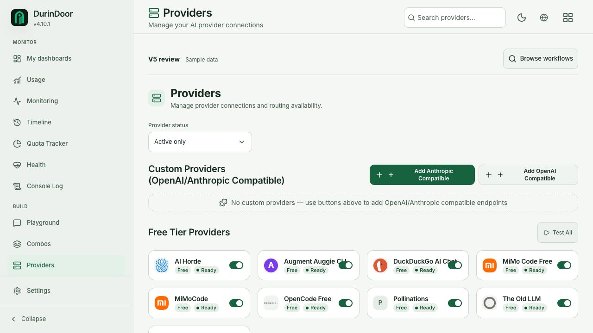
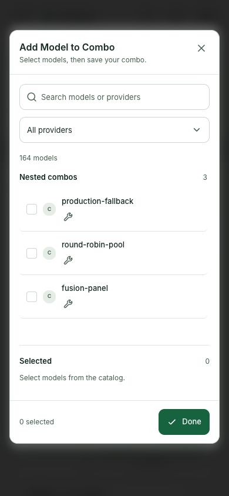
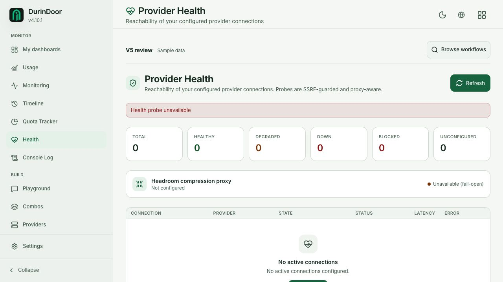

# DurinDoor v5 design review

The redesign needs another implementation pass before acceptance. This review records 29 confirmed defects and requirement gaps, including five high-priority problems with administrative state. Passing Storybook tests have not caught several broken workflows.

Review date: 2026-10-29. Source head: `250a42caaac957098cc46c0618cf6b78d8539df7`, branch `codex/v5-admin-storybook`. This round changes audit documentation only. Production integration and merge remain outside acceptance.

## Method and scope

Used [Visant Killer](https://github.com/pedrojaques99/visant-skills-public/blob/fe555cfdeb405799db51ca52468079512c9adc1a/visant-killer/SKILL.md), Frontend, Motion, Refine, and Copy with its English guidance, pinned to `fe555cfdeb405799db51ca52468079512c9adc1a`. The review combines three independent source reviews with rendered Storybook checks. It preserves DurinDoor's tokens, doorway identity, provider artwork, features, and the user's animated-icon requirements.

The target is the web admin and its login/callback flow. The separate `website/` marketing site, hosted services, live accounts, and public distribution/SEO are outside this audit. [Route classification](./surfaces.md) inventories all 40 Next page entries plus the proposed My dashboards route, including redirects and the excluded in-app landing page. Daily investigation is a B work surface. Access, configuration, and destructive regions are C trust surfaces.

Source review and detector reachability cover 539 active files, including 256 JSX interface modules. Of those interfaces, 182 use `.js`, which the unmodified tools would partly miss. Rejected prototypes and generated story wrappers are excluded from accepted design findings. See [detector calibration](./detector-adapter.md).

## Verification and its limits

| Check | Fresh result | What it proves |
|---|---|---|
| Active v5 catalog lifecycle and play functions | 854/854 completed, zero exceptions | Existing stories execute successfully on this built preview |
| Chromium accessibility and interaction matrix | 328/328 cases passed, light/dark and desktop/mobile | Existing representative axe and interaction checks pass |
| In-app-browser rendered snapshots | 164 snapshots, plus two reproduced 404 documents | 40 named page/state views sampled in both themes at 1280px and 390px, plus combo dialog and layout-edit views |
| Document overflow in rendered snapshots | 0px for all 164 rendered snapshots | The sampled documents fit; this does not prove that every child, label, or local scroller is usable |
| Visant detector calibration | Original self-tests and positive/negative adapter fixtures pass | `.js` JSX, token format, and tool failures are handled explicitly |
| Root anti-slop | Pass, zero diagnostics across 2377 files | Separate source check, not visual acceptance |
| Repository Storybook coverage gate | Failed | Existing manifest, source hashes and built IDs are inconsistent; see final check record |

The catalog and Chromium matrix wait for story completion. The snapshot sweep records rendered fixture views and can capture a story's intermediate or post-play state. It is not independent proof of every transition. Screenshots cover the viewport; `fullPage` does not expand the app's fixed inner scroll areas. Provider auto-sync was also scrolled into view and inspected separately. Source review covers controls below the sampled folds.

All values and requests are synthetic. A failed request was simulated only where an existing story supplied it. The other failure paths below are confirmed from source and still need focused failing-response scenarios. No real credentials, live provider calls, database changes, certificate installation, or account operations were used. Firefox/WebKit, forced colors, browser zoom, screen-reader speech, and motion performance were not freshly qualified in this round. Historical results are not substituted for them.

## Required fixes

P1 means the UI can misrepresent an important operational or configuration outcome. It does not assert a server authorization bypass. P2 means a broken interaction, misleading state, or unmet UI requirement. These fixes are required work, separate from the design choices later in this report.

| ID | Priority | Confirmed problem | Evidence and required response |
|---|---|---|---|
| W1 | P1 | Failed provider/media enable changes still paint the new state | [Workflow report](./workflows.md), provider list and media kind handlers. Check response, retain prior state or roll back, show retry. |
| D1 | P1 | Compression settings display rejected writes as saved | [Dashboard report](./dashboards.md), TokenSaverClient PATCH handlers. Use pending/confirmed/error states. |
| D2 | P1 | Failed quota discovery looks like no connected providers | Dashboard report, ProviderLimits fetch catch. Separate failure from confirmed empty. |
| D3 | P1 | Failed log transport still says Streaming | Dashboard report, console client and transport. Report connected, reconnecting, paused and unavailable truthfully. |
| S1 | P1 | Failed Settings discovery exposes editable off/empty defaults | [System report](./system.md), profile settings load. Keep unknown distinct and offer retry. |
| W2 | P2 | Integration outages look like absent configuration | Workflow report, proxy/media/MCP discovery. Preserve a loaded snapshot and show initial-load error. |
| W3 | P2 | MCP Keys discards the hook's existing error | Workflow report, McpGatewayKeysPage. Render the supplied error and recovery action. |
| W4 | P2 | Combo allow-list save rejection is silent | Workflow report, ReviewCombosPage and ComboAllowListEditor. Keep draft and show failure next to the editor. |
| W5 | P2 | Key revocation closes confirmation before checking the outcome | Workflow report, KeysPageClient. Confirm response, retain context, announce success/failure. |
| W6 | P2 | Repeated submission can mint multiple MCP keys | Workflow report, NewKeyDialog. Guard and await one request; handle failure in the dialog. |
| W7 | P2 | Timeout writes on every keystroke can complete out of order | Workflow report, ReviewCombosPage. Local draft plus ordered commit and row feedback. |
| W8 | P2 | Endpoint settings can show plausible defaults after discovery failure | Workflow report, EndpointPageClient. Load explicit known settings before dependent edits. |
| D4 | P2 | Polling fallback ignores paused logs | Dashboard report, ConsoleLogClient onSnapshot. Apply the same pause contract to SSE and polling. |
| D5 | P2 | PXPIPE loading/failure also claims no savings or events | Dashboard report, PxpipeWidgets. Distinguish loading, unavailable, empty and stale. |
| D6 | P2 | Monitoring says Online before the first response | Dashboard report, Monitoring page. Show unknown/loading until data exists. |
| D7 | P2 | Health failure simultaneously claims zero/no connections and unavailable Headroom | Dashboard report and screenshot below. A failed probe is not evidence of those facts. |
| D8 | P2 | Timeline says Listening after SSE disconnect | Dashboard report, Timeline page. Track actual stream lifecycle and reconnect state. |
| D9 | P2 | Hidden dashboard sources can display unrelated errors | Dashboard report, WorkspacesPage resource wrappers. Mount or report only sources needed by visible widgets. |
| D10 | P2 | Switching dashboards silently discards an unsaved layout | Dashboard report, active Select and keyed DashboardCanvas. Preserve draft or make discard explicit. |
| S2 | P2 | Database Last refresh is render time, not successful-fetch time | System report, database page. Record the timestamp after a valid response and identify stale data. |
| S3 | P2 | Prefix icons cannot receive pointer help/animation | System report, Input and Header pointer-events-none. Hit-test the glyph itself while preserving field focus and icon-only tooltips. |
| S4 | P2 | Translator buffers the whole stream and has no Stop action | System report, TranslatorWorkspace. Show partials, allow cancel, retain partial output on failure. |
| S5 | P2 | Auto-configure loses initial status failure | System report, server page and client error initialization. Propagate initial discovery failure into a recoverable state. |
| S6 | P2 | Some buttons have two leading icons | System report and reproduced DOM. Stable component identity/explicit metadata must prevent inferred icons duplicating authored icons. |
| S7 | P2 | Language switcher converts the locale flag into a second globe | System report, language glyph boundary. Preserve one language affordance and the intended locale mark. |
| S8 | P2 | Shell and page repeat the same title, subtitle and icon | System report and screenshots. Give one layer ownership of page identity; retain a semantic heading and useful actions. |
| R1 | P2 | Quota corrupts the isolated Storybook URL and the next navigation returns 404 | Detailed reproduction below. Keep application filter URLs inside the virtual navigation boundary. |
| R2 | P2 | Token Saver's Compression settings link leaves Storybook and returns 404 | Detailed reproduction below. Use the existing fixture-aware link/router. |
| R3 | P2 | Provider switches cover the ends of provider names | Detailed measurement below. Reserve a permanent action lane or put the switch in the row grid. |

The source reports contain exact paths, lines, effects, fixes, missing scenarios, and preserved behavior. Their individual browser limitations are superseded only by the explicit browser observations in this report, not by assumption.

### R1. Quota breaks subsequent isolated-preview navigation

1. Open Explore workspace in `/iframe.html` and follow Quota Tracker.
2. `ProviderLimits/index.js:574-585` builds a URL from the virtual application pathname, then calls real `window.history.replaceState`.
3. The document becomes `/dashboard/quota?id=...`, retaining Storybook parameters under an application pathname.
4. Follow Health. `ReviewFrame.jsx:10-22` reuses that pathname while changing the story ID. The static preview requests `/dashboard/quota?id=v5-review-pages-health--default...` and returns 404.

This was reproduced twice on the served built Storybook. It concerns the isolated preview path. The manager path has different parent-window behavior and is not claimed broken by this reproduction. Fix the boundary, rather than adding application-route fallbacks that hide it. Regression scenario: Usage to Quota, edit a filter, navigate to Health, reload, and use Back/Forward.

[404 screenshot](./screenshots/quota-navigation-404.png). Exact URLs are in [evidence.json](./evidence.json).

### R2. Compression settings escapes the fixture

`src/shared/ui/v5/dashboards/TokenSaverDashboard.jsx:12` renders a plain `<a href="/dashboard/token-saver/settings">`. It bypasses `.storybook/next-link.jsx` and the virtual router. After the overview story finishes, clicking it navigates the browser to the nonexistent static route and returns 404. The feature remains reachable through the sidebar's adapted link, so the defect is this primary workflow link rather than absence of the settings page.

[404 screenshot](./screenshots/token-settings-navigation-404.png). Add a complete dashboard-to-settings-and-back interaction after story playback settles. Apply the same review to button-styled anchors, including icon coverage, without changing navigation labels into unexplained symbols.

### R3. Provider names and toggles overlap

`src/app/(dashboard)/dashboard/providers/page.js:789-791` gives the title its normal content width. The control at `:828-850` is absolutely positioned over that content with no reserved trailing space. At 1280px in dark mode, the Augment Auggie CLI title intersects the switch hit area by 23.75px horizontally and 17px vertically. DuckDuckGo AI Chat intersects it by about 26.08px and 17px. The visible switch track also occupies that title lane.

The same collision is visible in light mode. A document-overflow check returns zero and cannot catch it. Add title/action intersection coverage at the four-column breakpoint, including the longest provider name and a touch device that cannot reveal controls through hover.

## Preserve these capabilities

- All seven Usage widget IDs remain: overview, provider topology, requests/sessions, token/cost trend, grouped usage, combo attribution, and key limits. Preserve custom periods, logs/details, separate data/layout reset, visibility, width, rename, keyboard/pointer move, and save/cancel.
- All nine Token Saver/PXPIPE widget IDs remain, separate from settings. My dashboards still composes Usage, Token Saver, quota and monitoring. Preserve the distinction between measured byte reduction and estimated image tokens.
- Combos retain strategies, nested members, order, weights, judge settings, capability ceilings, timeouts, connection/group allow-lists, clone/copy/delete, model aliases, typed media catalogs, no-auth/custom/auto-synced models, and paid-model filtering. No feature removal was confirmed in this review sample.
- Provider model auto-sync has its own card with enable/manual sync, last sync, catalog differences, unsupported/pending/error states. Keep it and the provider connection graph. [Auto-sync screenshot](./screenshots/provider-auto-sync-light-desktop.png).
- Retain native dialog focus/dismissal behavior, form serialization and validation through the select adapter, actual brand artwork, distinct Monitoring/Timeline symbols, animated icons, icon-only help, Close/Save exemptions and reduced-motion behavior.

This is a preservation checklist supported by current source. It is not an exhaustive production parity certification.

## Design proposals

These are choices, not additional confirmed defects. They must not erase controls, state feedback, or underlying features. No adoption was made in this audit.

| Area | Proposed composition | Operator benefit and preserved behavior |
|---|---|---|
| Page shell | One title/breadcrumb owner, one compact action/filter toolbar, quieter review switcher | More first-fold content; keep semantic heading, theme, language, account and route context |
| Dashboard summaries | Use three columns at this workspace width, two on narrow screens, six only when labels and units fit | Avoid tall squeezed cards and labels split into fragments; retain units, estimate qualifiers and status |
| Combos inventory | Compact ordered identity rows; primary model and remaining-member summary, expandable full chain | Scan several combos instead of one long capability legend; retain every member, order, weight and restriction |
| Model picker | Keep searchable grouped rows and explicit selection; show differentiating capabilities, with complete details on demand; compact the empty selected pane on mobile | More usable catalog space; preserve selection state, provider filter, icons/tooltips, manual IDs and Done action |
| Combo create/edit | Identity and members first; Capabilities and limits disclosure, auto-open when values exist | Shorter create path without hiding existing overrides or disabling functionality |
| Settings | Exclusive strategy choice shaped as one selection, conditional dependent controls, visible save status | Make mutual exclusivity and actual persistence legible; retain all routing choices |
| Long forms | Use the shared Field/Checkbox/Toggle/Select patterns and group advanced controls by consequence | Stable alignment and discoverability; keep validation and saved values visible |
| Token Saver | Same edit workflow as Usage, source-scoped status and explicit last-success time | Make errors relevant to visible widgets and keep dashboards/settings distinct |
| Login | Keep doorway silhouette, logo, pause and fallback; tune light-mode material/light separation | The current light gate washes into the pale background. Preserve vivid animation without increasing incidental dashboard motion |
| Copy and icons | Keep action names concise; remove repeated introductions; icons complement labeled actions | Do not replace obscure strategies, errors, grant scope, or destructive consequences with unexplained symbols |

## Repair order and acceptance scenarios

1. **Shared review boundaries.** Own icon identity, prefix hit testing, link navigation, and heading ownership together. Verify built/minified Storybook, not only development. Test one icon per button, icon-only pointer help, correct field focus, modal keyboard behavior, Quota navigation and Token Saver settings navigation.
2. **Trustworthy reads and writes.** Give every read explicit initial/loading/loaded/empty/error/stale states. Give every write draft/pending/confirmed/rejected states and request-order protection. Add first-load500, rejected network, later-refresh failure, retry, double submit, reversed response order, and save read-back stories for W1-W8, D1-D8 and S1-S5. Preserve loaded values during later failures.
3. **Dashboard lifecycle.** Preserve unsaved layouts across selection, load only required sources, show errors within affected widgets, and retain all widget IDs/actions. Test source outage with only a different source visible, all widgets hidden, missing saved widgets, keyboard drag, save/cancel/reset and switching a dirty dashboard.
4. **Density and form composition.** Apply the selected proposals across every page family. Verify title/action intersections as well as document overflow, long names, many members, zero/large/unknown measurements, both themes, narrow/intermediate/wide widths, touch and keyboard.
5. **Acceptance.** Re-run the catalog and browser matrix after repairs, add the missing behavior assertions, and perform another visual pass of affected screens. Required repository lint and full CI still gate a later implementation PR. Storybook review does not authorize production merge.

## Visant interrogation

These answers apply to the T3 admin flow. They distinguish actual product proof from review-only and unavailable evidence.

| Question | Answer and evidence | Required consequence |
|---|---|---|
| Q1 Who needs it? | Gateway operators need connection, routing and access controls; see provider page and `ReviewCombosPage.jsx:696-730` | Preserve capability; reduce incidental chrome |
| Q2 Need or available data? | Widget catalogs expose opt-in data in `usage/layout.js:5` and `dashboards/model.js:6-31` | Keep selection user-owned; do not add metrics solely because they exist |
| Q3 Why a screen? | Routing requires order, editing and comparison, `ReviewCombosPage.jsx:319-335` | Keep operational controls close to the resource |
| Q4 Fewest screens? | Separate Usage, Saver settings and custom composition is explicitly requested; `TokenSaverDashboard.jsx:12` | Repair links; do not merge these tasks back together |
| Q5 Which decision? | Select the usable model/account, then confirm the saved routing policy; W1/W4/W7 | Make save outcomes visible |
| Q6 Which datum decides? | Connection state and current saved strategy decide routing, not capability icon count | Promote truthful state and identity, compact metadata |
| Q7 Answer or raw material? | Model rows repeat capabilities while the operator must reconstruct a chain, `CapabilityIcons.jsx:8-10` | Offer a compact chain summary with full detail accessible |
| Q8 Defensible default? | Settings fake defaults on failure are documented in S1/W8 | A fallback display must not masquerade as a loaded decision |
| Q9 Optimal play/monetization? | This repository supplies a gateway admin; no billing experiment or product analytics was inspected | No invented revenue recommendation |
| Q10 Upgrade limit? | This audit concerns technical quota/key limits, not a sales upgrade; `ApiKeyLimitsCard.js` | Keep limit context; add no upsell |
| Q11 When do numbers lie? | Unknown becomes zero in Monitoring/Health/PXPIPE, D5-D7 | Separate unknown, failed, empty and measured zero |
| Q12 Backend failure? | D2/D3/W2/S1 are source-confirmed failure paths; Health error was visibly reproduced | Add focused failure stories for the rest |
| Q13 Unsupported promise? | Streaming/Listening and Last refresh can describe intent/render time, D3/D8/S2 | Derive labels from successful transport/data events |
| Q14 Failed optimism? | W1/D1 keep rejected settings in the UI | Confirm or roll back with actionable error |
| Q15 Ownership? | Review layout storage is namespaced, `dashboards/model.js:4-5` | Preserve review storage separation; live multi-user ownership not qualified |
| Q16 Pixels before content? | Provider first cards begin around542px in the 720px desktop view; duplicate header and review chrome are visible | Compact chrome before shrinking data or targets |
| Q17 Best/worst records? | Full capability/model catalogs and named provider overlaps were inspected; deliberate arbitrary-length stress was not | Add explicit longest-name/member-count fixtures |
| Q18 Wrong lesson? | Green success labels may survive disconnect or rejected writes | Make semantic color follow known state |
| Q19 Would the operator trust it? | Current configuration/status mismatches prevent an acceptance verdict | Fix state truth before visual promotion |
| Q20 What should be removed? | User requires no feature loss; optional capabilities are always open in `ReviewComboFormModal.jsx:376-398` | Use disclosure and hierarchy, not capability deletion |
| Q21 Which role? | Gateway operator; inventory is B and mutation is C in `surfaces.md` | Optimize repeated work and deliberate changes separately |
| Q22 What remains distinctive? | Gateway-specific topology, routing/capabilities, modality catalogs and doorway identity | Preserve real product mechanisms and brand artwork |
| Q23 Promise versus proof? | 854 stories pass while 29 confirmed gaps remain | Treat catalog success as bounded evidence, not readiness |
| Q24 Layer consistency? | Admin/access reviewed; public site and pricing are excluded | Do not claim full acquisition-to-billing coherence |
| Q25 Category error? | Work and trust UI is being reviewed, not a marketing landing page | No decorative hero bands or persuasion chrome in admin |
| Q26 Who maintains it? | Existing generator, manifest and browser tests define the review, `scripts/gen-v5-stories.mjs` and `v5-storybook.browser.test.js` | Extend reusable checks for each confirmed gap |
| Q27 Maintenance value? | No commercial pricing or operator-time study was conducted | Prioritize failed save/navigation recovery; do not invent pricing or ROI |
| Q28 Three-month regret? | Cosmetic convergence would leave false operational state untouched | Gate acceptance on truthful state, feature preservation and working workflows |

### Fixed questions F1-F6

- **F1 Reuse.** Existing Button, Input, Field, Checkbox, Toggle, Select, Modal, ProviderLogo and dashboard canvas were found and reviewed. No new design-system primitive was added. Review replacements currently duplicate substantial production logic, so promotion requires parity checks rather than wholesale replacement.
- **F2 Consistency.** Durin DS tokens are complete CSS colors. Keep green action/information tokens and semantic warning/destructive states. Brand marks and editor syntax are legitimate distinct colors. Two leading icons and duplicated page introductions are confirmed composition failures.
- **F3 Responsive/performance.** 164 rendered snapshots have 0px document overflow; 328 existing Chromium cases pass. Provider title/control intersections still fail at 1280px. No INP, animation-frame, memory or CPU benchmark is claimed. Sidebar width animation and timing-token consolidation remain candidates, not measured jank.
- **F4 Progressive flow.** Inventory, identify resource, inspect, edit, confirm, read back. Current breaks occur at navigation and confirmation. Keep recovery in context rather than closing dialogs early or hiding the task behind explanatory text.
- **F5 Hide/compact/iconize.** Hide optional capability overrides behind a named disclosure; compact repeated headings and metadata; use icons for familiar secondary actions with accessible names/help. Never hide current restrictions, write errors, grant scope or estimate qualifiers. Pixel savings are not estimated without a prototype measurement.
- **F6 Highest leverage.** First fix state truth and mutation outcomes, then shared icon/navigation defects, then density. Keyboard and reduced-motion code safeguards exist; screen-reader speech, fresh cross-engine qualification and runtime motion budgets remain unverified.

## Detector results and exceptions

| Detector | Calibrated result | Review disposition |
|---|---:|---|
| Impeccable CLI | Unavailable | npm execution errors are tool failures, not ten UI bugs |
| Killer token fallback | 52 candidates | Requires consumer inspection; 26 CLI color entries are third-party identity metadata |
| Killer extracted Copy | 105 candidates | Style candidates do not authorize rewriting clear existing copy |
| Killer Noise | 153 candidates | Not153 confirmed defects; parent composition and visible controls decide |
| Refine | 26 candidates | Seven chart-state, seven defs-ID, three layout-animation and nine easing/property candidates |

The raw candidate totals are not added to the 29 accepted findings. An unknown animation performance cost is not a benchmark. Repeated gradient IDs need a multi-instance reproduction before being called a visible chart defect. A chart-state wrapper may live in a parent. Zero can be meaningful operational data when it was actually measured; it must not be removed just to follow a general taste rule.

The calibration repairs are documented in `detector-adapter.md`: JSX in `.js`, actual complete-color tokens, installed AnimateIcons recognition, pinned Copy path, and truthful unavailable-tool handling. Positive and negative fixtures prove those changes. The rerunnable adapter and full raw logs stay in the local audit artifact directory documented there. No scan baseline or product suppression was added.

Killer remains closed and Refine blocked. The repository's separate Storybook coverage gate also fails. A whole-app numerical design score is withheld: an unavailable gate and unexecuted failure-path/performance checks cannot support an acceptance score. This is an audit with required fixes, not a release certificate.

## Not changed or freshly qualified

No product source, tests, dependencies, settings or production routes changed. No branch merge or deployment was performed. Full repository CI, root ESLint, build regeneration, Firefox/WebKit, native/mobile device behavior, hosted authentication and live gateway parity were not rerun for this documentation-only review. The static build was the recovered head under review. Later implementation needs the repository's complete PR gates.

## Final check record

The catalog run completed in 87.73 seconds. The Chromium matrix completed in 164.74 seconds. These are execution durations, not application performance measurements. The matrix contains 328 passed cases and zero captured page errors. Root anti-slop returned zero diagnostics across 2377 files.

`npm run check:storybook-coverage` exited 1. Its output includes 134 missing manifest rows, 116 source-hash reports and 1113 orphaned built-story IDs. The manifest still names older `durin-ds-production-pages-*` scenarios and records `EXECUTION_PENDING_RUNTIME_PROOF`; the built catalog contains renamed production stories and generated v5 wrappers. These are coverage-metadata failures, not 1113 proven broken screens. Reconcile the source census, approved scenario IDs, exact source hashes and required runtime artifacts before claiming the repository's coverage gate is green. Do not remove assertions or approve manifest rows merely to absorb the current build. This gate issue is additional verification debt, separate from the 29 UI findings.

Documentation checks verified 29 unique findings, five P1 and 24 P2, all local report/image links, 164 rendered snapshot records, zero document overflow in those records, 328 Chromium cases and both reproduced navigation failures. `git diff --check` passes. The eight repository-local screenshots contain synthetic fixtures only. Full raw logs, all snapshot images, the detector adapter and calibration fixtures remain in `/Users/heitor/Documents/Codex/durindoor-visant-audit-2026-10-29/`. No product code or suppression baseline changed.

## Repair pass

See [the finding-by-finding repair record](./fixes.md) for implementation and regression mappings. Historical audit evidence above describes the pre-fix head; current qualification belongs to the PR exact-head results.
