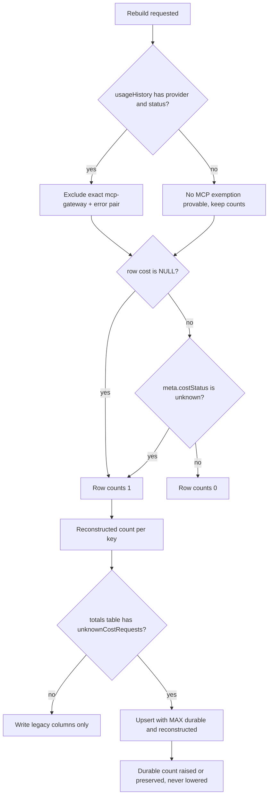

# Unknown-cost count preservation in historical usage rebuilds (issue #1655)

Status: ordinary author validation completed for the source corrections after independent REQUEST CHANGES on `183243d342f19b3494b4af08d067c89cc56e093d`. The branch includes PR #1653 through `eb5b52f5`. Fresh exact-head independent review and the trusted full checkpoint remain pending; author results are not approval or readiness.

Owner lens: accounting rebuild semantics and cross-engine parity. The MCP identity and exemption work stays with #1653, which remains frozen and unmerged.

Base reviewed: `f0c21bf6ef2e8c7baaaadeaa96be5491815a9c46`.
PR #1653 head integrated: `eb5b52f5c630f9bce315100b237bee36c4dfcb86` (open, draft, not merged).

## 1. The defect

At the inherited base, two historical rebuild helpers dropped the durable unknown-cost count when rebuilding per-key lifetime totals from retained history.

| Path | File | Lost value |
| --- | --- | --- |
| Missing totals row | `src/lib/db/helpers/apiKeyUsageTotals.js:44-49` | `INSERT` names 5 columns, so a new row takes `unknownCostRequests` DEFAULT 0 |
| Legacy replacement | `src/lib/db/migrations/apiKeyUsageTotalsBackfill.js:43` | `INSERT OR REPLACE` deletes the row, so an omitted column returns to DEFAULT 0 |

The defect predates #1653. Both prior independent reviews reproduce `unknownCostRequests: 1 -> 0` against the exact base with a non-MCP fixture.

A third path does not lose the value but never reconstructs it: the helper's overwrite branch (`src/lib/db/helpers/apiKeyUsageTotals.js:41-43`) omits the column from the `DO UPDATE SET` list, so an existing durable count is preserved and never repaired.

## 2. The runtime counter predicate

The durable column is defined at `src/lib/db/schema.js:135-142` and written at runtime by `incrementApiKeyUsageSync` (`src/lib/db/repos/apiKeyUsageTotalsRepo.js:67-92`).

Runtime predicate, `src/lib/db/repos/usageRepo.js:832`:

```js
entry.unknownCostRequests = entry.cost === null ? 1 : 0;
```

The request validation at `src/lib/db/repos/usageRepo.js:793-796` makes `cost === null` and `costStatus === "unknown"` the same condition: `costStatus === "unknown"` requires a null cost, and a non-null cost requires `known` or `estimated`. A numeric cost with `costStatus: "unknown"` therefore cannot be produced by the current writer.

Migration 026 uses two branches (`src/lib/db/migrations/026-usage-unknown-cost.js:29-47`):

1. `cost IS NULL`
2. `cost IS NOT NULL AND meta.costStatus === "unknown"`

Branch 2 covers legacy and imported rows only. The branches are disjoint, so a row contributes at most one.

Consequence for a rebuild: the reconstruction must use both branches to match the durable column's established definition. A reconstruction that used only branch 1 would be lower than what 026 seeded for the same history.

## 3. Lower bound versus exact count

Retained history is a lower bound on the durable unknown-cost counter, never an exact reconstruction.

- `pruneUsageBeforeInTx` deletes history rows (`src/lib/db/repos/usageRepo.js:1955`) and resets the global lifetime counter (`src/lib/db/repos/usageRepo.js:1972-1973`), but never touches `apiKeyUsageTotals`.
- `resetUsageHistory("all")` deletes every history row (`src/lib/db/repos/usageRepo.js:2004`) and never touches `apiKeyUsageTotals`.
- `incrementApiKeyUsageSync` only adds. `adjustApiKeyUsageSync` subtracts only when an accepted job is retracted, and that path deletes the matching history row too (`src/lib/db/repos/usageRepo.js:998-1003`).
- The current restore path imports durable totals (`src/lib/db/index.js:609-616`) while detaching history attribution, so a restored database holds a count that its retained history cannot explain.

So the durable unknown-cost counter is a lifetime value and the reconstruction is a bound. The rules that follow.

### Scope of the lifetime rule

The lifetime rule above is a property of the unknown-cost count. It is not a statement about the other three totals.

The helper's overwrite branch replaces `totalTokens`, `totalCost`, and `totalRequests` with the reconstruction, and that behaviour is pinned by an existing regression: `tests/unit/api-key-committed-tokens.test.js:47-48` expects an overwrite to restore `totalRequests` from 2 back to 1 even though the durable row held the larger value. Changing that is outside this issue.

The unknown-cost count is treated differently on purpose. It is a disclosure counter: its only purpose is to tell the operator that some requests could not be priced. Replacing it with a reconstruction that is a lower bound would turn "five requests were unpriced" into "zero requests were unpriced" and remove the signal, rather than restate a smaller truth. Migration 026 established that rule for this column with the comment that retained history proves only a lower bound and that a larger durable count is never reset on retries (`src/lib/db/migrations/026-usage-unknown-cost.js:5-6`).

One consequence is visible and worth naming. After an overwrite rebuild on a database whose history was truncated, the row can hold a durable `unknownCostRequests` of 7 next to a rebuilt `totalRequests` of 0. That incoherence is a property of the existing replace semantics for the other totals, not of this repair. The alternative, making all four totals monotonic, would change the pinned overwrite contract and belongs to a separate decision.

### U1 Eligibility

A history row counts toward one key's unknown-cost count iff all three hold:

1. `usageHistory.apiKey = apiKeys.key`, the exact literal secret join used by 026 and by the legacy helper.
2. Not the exempt pair: `provider === 'mcp-gateway'` AND `status === 'error'`, compared NULL-safe and exact-lowercase.
3. `cost IS NULL`, or `cost IS NOT NULL AND meta.costStatus === 'unknown'`.

Rule 3 has disjoint branches, so one row contributes at most one.

### U2 Guarded columns

- If `usageHistory` lacks `provider` or `status`, no MCP exemption is provable, so the counts are kept and the eligibility clause is empty. This is the shape 026 uses at its head and the shape the legacy helper already uses.
- If `apiKeyUsageTotals` lacks `unknownCostRequests`, the column is not written. The helper does not alter the table.

### U3 Monotonic composition

The rebuilt value is `MAX(durable, reconstructed)`. The durable count is never lowered.

### U4 Idempotence

The reconstructed value is recomputed from history on every pass and never accumulated onto the durable value, so repeated rebuilds return the same number.

### U5 No epoch crossing

Attribution happens only through the literal secret join of U1. The restore path rotates the billing epoch (`src/lib/db/index.js:520-522`) and clears `usageHistory.apiKey` for every retained row (`src/lib/db/index.js:538`) inside the same transaction. A previous epoch's row therefore has no joinable key and cannot be attributed to a post-restore key. No fallback attribution by name, HMAC, or orphan reassignment may be introduced.

### U6 Unchanged totals

`totalTokens`, `totalCost`, and `totalRequests` keep their current reconstruction rules. Only the unknown-cost count is added.

### What U3 does and does not claim

U3 is a composition rule for the never-lower direction. It is not a claim that the durable count equals the historical truth.

- The durable count may legitimately exceed the reconstruction: pruning, a full history reset, a restored backup, and legacy numeric-unknown rows all produce that.
- U3 can raise the durable count above the runtime-accumulated value when legacy numeric-unknown rows exist, because 026 counts them and the runtime predicate cannot. That raise is deliberate and consistent with 026. It is not a double count, because the current writer cannot produce such a row.
- U3 cannot correct an overcount written by base 026, which counted legacy MCP-error rows before #1653 added the exemption. Lowering that value needs a separate, explicit, audited downward correction. It is out of scope here.

## 4. Rebuild decision flow



## 5. Cross-engine divergence

The inherited legacy replacement diverged between engines before this patch.

- SQLite executes real `INSERT OR REPLACE`, which deletes the row and re-inserts it. An omitted column returns to its default, so the durable count becomes 0.
- PostgreSQL never sees that statement. `rewriteSqliteDml` (`src/lib/db/dialects/postgres/dmlRewrite.js:100-153`) rewrites `INSERT OR REPLACE` into `ON CONFLICT ("apiKeyId") DO UPDATE SET` over the listed columns only (`:122-153`). `unknownCostRequests` is not listed, so PostgreSQL preserves it.

That inherited helper reset the count on SQLite and preserved it on PostgreSQL.

### Proposed portable write

Both engines must run the same statement, so the replacement has to become an upsert. `INSERT OR REPLACE` cannot express U3 on SQLite, because the row is deleted before the replacement value is computed, so a monotonic expression would read the default instead of the durable value.

```sql
INSERT INTO apiKeyUsageTotals(
  apiKeyId, totalTokens, totalCost, totalRequests, unknownCostRequests, updatedAt
) VALUES(?, ?, ?, ?, ?, ?)
ON CONFLICT(apiKeyId) DO UPDATE SET
  totalTokens = excluded.totalTokens,
  totalCost = excluded.totalCost,
  totalRequests = excluded.totalRequests,
  unknownCostRequests = CASE WHEN apiKeyUsageTotals.unknownCostRequests < excluded.unknownCostRequests
    THEN excluded.unknownCostRequests ELSE apiKeyUsageTotals.unknownCostRequests END,
  updatedAt = excluded.updatedAt
```

The PG rewrite leaves a statement that already carries `ON CONFLICT` untouched, so this SQL runs unchanged on both engines. The monotonic expression is the `CASE WHEN` form that migration 026 already uses (`src/lib/db/migrations/026-usage-unknown-cost.js:51-54`). A two-argument `max()` exists in SQLite but not in PostgreSQL, where the column is a bigint, so the scalar form is not portable. Prior PostgreSQL diagnostics exposed that difference, but those attempts are not accepted isolated parity proof.

## 6. Applied patch and ownership

Applied on the author branch, which fast-forwards onto #1653 (`eb5b52f5`) first. #1653 stays frozen and unmerged; this branch depends on it and does not modify it.

### `src/lib/db/helpers/apiKeyUsageTotals.js`

Was a conflict with #1653, which edits the same file. Integrated by fast-forward, then extended.

1. Read `provider`, `status`, and `meta` from `usageHistory`, guarded by a column probe, and apply the eligibility clause of U1 and U2.
2. Count eligible rows in the existing reduce and carry the result as `unknownCostRequests`.
3. Write the column only when the totals table has it.
4. On the overwrite branch, set `unknownCostRequests = MAX(apiKeyUsageTotals.unknownCostRequests, excluded.unknownCostRequests)`.
5. Leave the non-overwrite branch as `DO NOTHING`, so an existing row is never touched by a fill pass.

Note on the `006` caller: `src/lib/db/migrations/006-api-key-policy.js:22` runs the helper during a v5 to v6 upgrade, before migration 026 adds the column, so the column probe of U2 must tolerate its absence there.

### `src/lib/db/migrations/apiKeyUsageTotalsBackfill.js`

Was a conflict with #1653, which edits the same file. Integrated by fast-forward, then extended.

1. Add the unknown-cost aggregate with the eligibility clause of U1 and U2. The legacy numeric-unknown branch needs JS metadata parsing, the same way migration 026 does it (`src/lib/db/migrations/026-usage-unknown-cost.js:44-46`).
2. Replace the `INSERT OR REPLACE` with the portable monotonic upsert of section 5.
3. Keep the existing property that rollups without a current API-key row are left untouched.

### Not changed

- No change to the current restore path (`src/lib/db/index.js:609-628`).
- No downward correction of any durable count.
- No change to the overwrite semantics of `totalTokens`, `totalCost`, and `totalRequests`, which the existing regression pins.
- No change to `src/lib/db/migrations/026-usage-unknown-cost.js`, which #1653 owns.
- No change to `src/lib/db/repos/usageRepo.js`, which #1653 owns.
- No change to the #1653 test files or its PostgreSQL worker.

### Schema version

`src/lib/db/schema.js:9` carries `SCHEMA_VERSION`, the latest schema version. Adding migration 028 moves it from 27 to 28. The registry test asserts that constant equals the highest registered version (`tests/unit/db-migrations-registry.test.js:28`), and the migration chain tests read the same constant.

## 7. Repairing already-built totals

Editing migration 026 does not repair anything. A database that already recorded version 26 does not run it again (`src/lib/db/migrate.js:100-120`, `:129-149`), and 026's write is monotonic, so it cannot lower a value either.

B2 is implemented as a new forward migration.

### Version choice

`028`, with the name `usage-unknown-cost-repair`.

- The SQLite registry held versions 001 to 018 and 020 to 027 (`src/lib/db/migrations/index.js`), so `latestVersion()` was 27.
- Version 019 is reserved for the PG-only cutover log and must not be reused (`internal/docs/postgres-migrations.mdx:39-47`).
- The PG registry must carry the same `{version, name}` pair for every shared version, and extra PG-only versions are permitted (`scripts/check-postgres-migrations.mjs:24-40`).

So 28 was the next free shared version. The inventory was re-read after the fast-forward onto #1653, which added no migration, so 28 was still free.

### Files

- `src/lib/db/migrations/028-usage-unknown-cost-repair.js`, new, dialect-aware like 026.
- `src/lib/db/migrations/index.js`, the import and the registry entry.
- `scripts/migrate-sqlite-ddl-to-pg.mjs`, a `num === 28` branch that emits the thin re-export, the same shape as the 026 branch.
- `src/lib/db/migrations/postgres/028-usage-unknown-cost-repair.js`, generated.
- `src/lib/db/migrations/postgres/index.js`, generated. It is auto-generated and was not hand-edited (`scripts/migrate-sqlite-ddl-to-pg.mjs:320`).

Future authorized generation/check commands are `node scripts/migrate-sqlite-ddl-to-pg.mjs` and `npm run check:postgres-migrations`. Earlier reported passes are retained but not accepted isolated evidence. Source inspection shows that the generator emits a fixed default re-export for 028, so the named-export and absent-source corrections require no generated-file or template change. Neither command ran during this source-only follow-up.

### Engine contract

- Table reflection follows 026: `PRAGMA table_info` on SQLite, `information_schema.columns` filtered by `current_schema()` on PostgreSQL (`src/lib/db/migrations/026-usage-unknown-cost.js:22-24`). A `PRAGMA` translation also exists (`src/lib/db/dialects/postgres/translate.js:169-182`), but 026 uses the explicit branch, and the repair should match it.
- The write is the portable upsert of section 5.
- The rebuild uses the eligibility clause and the two disjoint cost branches of U1, and it applies U3, so it never lowers a durable count.

### Transaction, failure, and idempotency

- `applyVersionedMigrations` wraps each `up()` in `adapter.transaction(...)` and records the version in `appliedMigrations` and `schemaVersion` only after `up()` returns (`src/lib/db/migrate.js:139-145`). A failure rolls back and leaves version 28 unapplied, so the migration stays retryable. The PostgreSQL adapter uses `BEGIN` / `COMMIT` / `ROLLBACK` with savepoints (`internal/docs/postgres-migrations.mdx:140`).
- Re-running is safe. The repair recomputes the reconstruction from history and applies U3, so a second pass returns the same value.
- A database that already recorded version 28 does not run it again. A hand-rewound `schemaVersion` re-runs it (`src/lib/db/migrate.js:111-117`), which is safe under U3.
- Guards inside migration 028 skip reconstruction when the destination unknown-cost column, `usageHistory`, or `apiKeys` is absent. SQLite startup runs migrations before additive schema sync, so an already-applied 026 cannot recreate missing sources for 028. A skipped reconstruction preserves every durable field and lets startup recreate empty tables. It creates no history and catches no reflection, query or write errors. Migration 026 remains unchanged.
- Malformed `meta` metadata must be tolerated, not fatal, the same way 026 tolerates it (`src/lib/db/migrations/026-usage-unknown-cost.js:44-46`).

### What the repair cannot fix

A durable count that base 026 overcounted for legacy MCP-error rows stays as it is, because U3 never lowers. That direction needs a separate, explicitly approved downward correction.

## 8. Regression coverage

The source-only review identified F1, a version-27 startup failure when history is absent, and gaps G1/G2 in legacy monotonicity and real-028 rollback coverage. Fresh ordinary author execution covered the following cases:

- `tests/unit/db-migration-chain.test.js` builds a file-backed database with the real registry through 027 and 026 already recorded. One startup case drops history and checks additive recreation, all durable fields, the new 028 marker and reopen idempotence. Another uses a SQL trigger that fails only after the first key's repair is visible. It checks rollback of both keys and both migration markers, then retry and reopen with repeat writes forbidden.
- `tests/unit/api-key-usage-unknown-cost-rebuild.test.js` calls the actual legacy helper with durable/history counts 5/1, 5/0 and 0/1. A shared matrix calls all three entry points for NULL and numeric-unknown costs, exact MCP errors, NULL attributes, case/whitespace/provider near misses and double-count prevention. Absent-source cases preserve the full durable row. Synthetic 900/901 runner tests and the handwritten SQLite monotonic-upsert control were replaced by actual migration/helper coverage.
- `tests/unit/db/postgres-unknown-cost-rebuild-live.test.js` and its owned worker prepare version 27 through the real PostgreSQL registry using the production synchronous adapter, with no injected client factory. The upgrade test exercises real 028 through the transaction runner, failure on the second repair, marker/data rollback, retry and a normal production-driver reopen. The legacy-helper cases distinguish larger, empty-history and lower durable counts. This remains opt-in; a skipped test is not PostgreSQL proof.
- The SQLite repair upsert is also passed through the PostgreSQL adapter with an injected client to check its SQL and parameters without a server. This test does not prove PostgreSQL execution. The worker fixture preserves an explicitly null metadata value. These additions await execution.
- Explicit zero-unknown assertions extend the existing production schema-v5/legacy-import caller checks and committed-token overwrite checks. Existing policy/backup restore tests already assert imported unknown counts and epoch fencing; their behavior is unchanged.

The new F1 startup regression failed against the published `183243d3` migration with `no such table: usageHistory`. With the guard restored, all 227 assertions in the 11-file SQLite/caller selection passed, including F1 and real-028 rollback/retry/reopen. The opt-in PostgreSQL selection passed all 12 assertions. All 14 PostgreSQL worker close checks observed natural exit with code 0. JSON/JUnit, raw logs and input hashes were retained for both selections.

## 9. Evidence limits

The independent source review at `183243d3` returned REQUEST CHANGES. Its retained report SHA-256 is `fea31e97fd037e852634f69700abe51427b22c53190d555fbbc332c9da2cbf0e`. Local corrections do not change that verdict or the reviewed head.

- The previously reported 193 SQLite assertions, PostgreSQL results, lint/docs and generated checks are retained historical outputs, not accepted isolated execution evidence. The probe checked private HOME, ABI and a credential denylist. It did not prove real-home/network denial in the parent and child; the supervisor did not enforce an OS sandbox or an allowlisted environment.
- The Kimchi preseed and 240-second timeout attempts remain rejected. The preseed was removed and the 60-second fixture timeout restored. The refused sudo/firewall probe was not retried. Root verified removal of the three shared Homebrew links; their retained objects and all failed receipts remain private evidence. Private relocated binaries do not establish isolation by themselves.
- The historical lint-staged diff run failed on the anonymous default export in migration 028. The named-object/default-export correction addresses that source cause. The historical no-staged-files run is not hook acceptance, and the original complete hook/range/title receipts remain missing. Fresh staged-hook and commit checks are recorded separately with the publication evidence; they do not retroactively repair that historical gap.
- Fresh execution used explicit `/usr/bin/sandbox-exec` and `/usr/bin/env -i`, copied Node 26.13.0/ABI 147, private HOME/DATA/cache/reports and two Vitest fork workers. Each launch first verified external TCP and synthetic real-home sentinel read/write `EPERM` in the parent and a spawned child, before candidate imports. PostgreSQL used a new owned private cluster, loopback port 55455 only, copied private binaries and read-only retained private libraries. No shared symlink writes, real database, credentials, updater preseed, loader or timer suppression were used.
- Fresh SQLite execution retained nine Kimchi VM-import diagnostics. The 14 PostgreSQL worker logs retained 14 Kimchi fetch/DNS failures and module warnings; no handler or timer was suppressed. The first fresh SQLite full-selection attempt ended with session exit 143 before its supervisor completion receipt, with an empty JUnit file. Its cause is undetermined and it remains a failed attempt. A new labeled run with streaming logs passed; that retry does not turn the interrupted run into a pass.
- The runtime results cover these ordinary author selections only. Final source/commit binding, hook and commitlint outcomes are separate publication records. A fresh independent exact-head review and trusted full checkpoint are still required. No gate status, review approval or merge readiness follows from these results.
- `ensureAndBackfillApiKeyUsageTotals` has no production caller in the reviewed head; its old caller description is stale. Direct tests establish its exported contract only. Production startup/import evidence uses `backfillApiKeyUsageTotals` and the real runner.
- Minimal schemas without attribution columns are artificial compatibility fixtures. F1 instead models a supported SQLite additive-recovery path after migrations through 027 were recorded. The guard does not add PostgreSQL additive schema recovery.
- No automatic downward correction of historical overcounts is authorized. The age and origin of legacy numeric-unknown rows and any real installation's prior MCP overcount remain unproven.

## 10. Open decisions

1. Merge order against #1653, which edits both production files. The author branch fast-forwards onto #1653, so #1653 lands first and this branch follows.
2. The repair is limited to the unknown-cost count. No downward correction is included, and none is proposed.
3. The PostgreSQL parity suite is a separate opt-in file, because `tests/unit/db/postgres-accounting-live.test.js` and `tests/fixtures/postgres-accounting-worker.mjs` are owned by #1653.

## Validação manual

Numbers a reviewer can check by hand against the rules above.

Case 1, the defect, missing totals row.

- History for one key: one row with `cost` NULL, `provider` openai, `status` ok.
- U1 rule 1 matches, rule 2 does not exempt, rule 3 branch 1 applies, so the reconstruction is 1.
- No durable row exists, so the insert writes 1.
- Base behaviour writes 5 columns, so the column takes its default 0. The defect is 1 against 0.

Case 2, the defect, legacy replacement.

- Durable row for one key: `unknownCostRequests` 1, `totalRequests` 1.
- History for the key: one row with `cost` NULL, `provider` openai, `status` ok, so the reconstruction is 1.
- U3 gives `MAX(1, 1)` = 1.
- SQLite `INSERT OR REPLACE` deletes the row, so the base result is 0. The defect is 1 against 0.
- PostgreSQL keeps 1 today, because the rewritten `DO UPDATE SET` does not list the column. The two engines disagree.

Case 3, the MCP exemption.

- History for one key: one row with `cost` NULL, `provider` mcp-gateway, `status` error.
- U1 rule 2 exempts it, so the reconstruction is 0 and the durable count stays 0.
- One row with `provider` openai and `status` error is not exempt, so the reconstruction is 1.
- One row with `provider` MCP-Gateway is not exempt either, because the comparison is exact lowercase, so the reconstruction is 1.
- One row with `provider` mcp-gateway and `status` " error" is not exempt, because the comparison has no whitespace tolerance, so the reconstruction is 1.

Case 4, the monotonic guard.

- Durable `unknownCostRequests` 5, `totalRequests` 9.
- History holds one eligible row, so the reconstruction is 1.
- U3 gives `MAX(5, 1)` = 5. The durable count stays 5.
- A plain assignment would give 1 and destroy 4 counted requests.

Case 5, retained history truncated.

- After a rebuild the durable count is 1.
- Retention pruning removes every history row. The durable count stays 1.
- A rebuild with an empty history reconstructs 0, and U3 gives `MAX(1, 0)` = 1. The count survives.
- A plain assignment would give 0 and erase the request.

Case 6, restored backup.

- The restore imports `unknownCostRequests` 7 with no history row that explains it.
- A rebuild reconstructs 0, and U3 gives `MAX(7, 0)` = 7. The imported count survives.
- A plain assignment would give 0 and erase 7 counted requests.

Case 7, the legacy numeric-unknown row.

- History for one key: one row with `cost` 0 and `meta.costStatus` unknown, plus one row with `cost` NULL and the same metadata.
- U1 rule 3 branch 1 counts the first row, branch 2 counts the second row, and the branches are disjoint, so the reconstruction is 2.
- A second rebuild recomputes 2 and applies `MAX(2, 2)` = 2. The count does not double.
